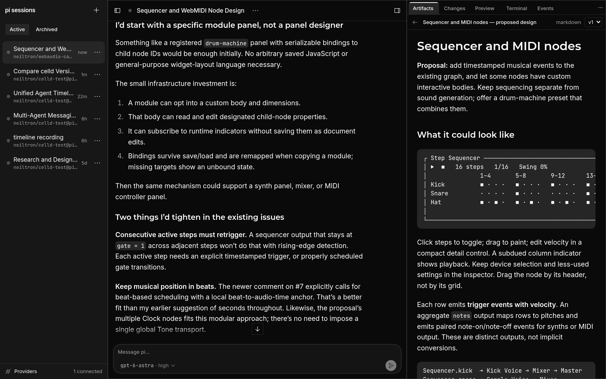

# boxen

boxen is a web app for [pi](https://github.com/earendil-works/pi) coding
agents. You install it on your own server. Each Session is one agent in its
own Linux container.



- The agent runs on the server. If you close the browser, the agent continues.
  After a server restart, the Session continues its run.
- All browsers on a Session show the same live transcript.
- Each container has a `/workspace` directory. boxen can clone a repo into it.
  After each run, boxen copies `/workspace` to storage. A new container gets
  this copy. Processes do not continue in the new container.
- The side panel has five views: Artifacts, Changes, Preview, Terminal and
  Events.
- You can use all model providers that pi supports.
- Scripts and other agents can control Sessions with the `boxen` command or
  the MCP server.

**Warning:** boxen has no user accounts. All persons who can connect to boxen
can use all Sessions, terminals and credentials. Do not connect boxen to the
internet.

## Requirements

- x86-64 Linux with systemd: Omarchy, Arch, Ubuntu 22.04+ or Debian 12+.
  Ubuntu on EC2 is satisfactory.
- 8 GiB RAM and 40 GiB disk.

## Install

```sh
git clone https://github.com/neiltron/boxen.git
cd boxen
./install.sh --access tailscale   # HTTPS on your tailnet
# or
./install.sh --access local       # http://localhost:8093, this machine only
```

1. When the installer asks, type your sudo password.
2. Open the URL that the installer shows.
3. In the sidebar, open Providers. Add a model API key or sign in to a provider.
4. In the sidebar, push +. Optional: type a repo URL. Push Create.
5. Type a prompt.

The installer installs Docker if it is necessary. It also installs Node,
celld, RustFS and two systemd services, `boxen` and `boxen-storage`. If
Tailscale needs a login, the installer makes a local install and shows the
next step.

## Upgrade

1. Run `git pull` in the checkout.
2. Run `./install.sh` again.

The upgrade keeps your Sessions and credentials. If celld restarts, each
container loses the file changes from after its last run.

For more procedures and limits, see [Installation](docs/installation.md).

## Cloudflare

boxen uses the Cloudflare Workers APIs. [celld](https://github.com/denoland/celld)
supplies these APIs on your server. There are no instructions or tests for
Cloudflare yet.

## Docs

| Doc | Contents |
|---|---|
| [Installation](docs/installation.md) | Install options, `boxenctl`, networking, storage, limits |
| [Using boxen](docs/using.md) | Rename and archive, Preview, Terminal |
| [Scripts and agents](docs/automation.md) | The `boxen` command, the MCP server, a turn from Node |
| [How boxen works](docs/architecture.md) | Cells, the agent loop, containers, repo layout |
| [Session protocol](docs/session-protocol.md) | The messages on a Session WebSocket |
| [Development](docs/development.md) | Run from a checkout, checks, the API contract |
| [Releases](docs/releases.md) | Versions, pinned dependencies, upgrades |
| [Changelog](CHANGELOG.md) | Changes in each release |
