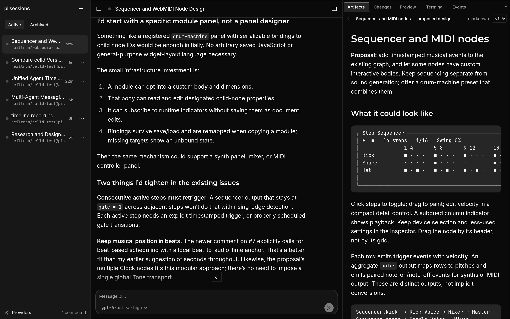

# boxen

boxen is a self-hosted web app for [pi](https://github.com/earendil-works/pi) coding agents. Each Session runs a persistent coding agent backed by its own isolated Linux container.



## Features

- **Persistent background runs:** Agents execute inside Durable Object cells on your server. Closing your browser doesn't interrupt a run, and in-progress Sessions resume automatically after a server restart.
- **Isolated sandboxes with checkpointing:** Every Session gets its own Linux container with a `/workspace` directory and optional Git clone. After each run (and before idle sleep), `/workspace` is checkpointed to S3-compatible object storage (Cloudflare R2, AWS S3, or local RustFS) and restored automatically when a new container starts. Running processes do not carry over across container restarts.
- **Multi-browser live sync:** Open the same Session across multiple tabs or devices to view the live transcript and steer the agent over WebSockets.
- **Dockable workspace panel:** Inspect agent output alongside chat with five Trellis views: **Artifacts**, **Changes**, **Preview**, **Terminal**, and **Events**.
- **Any `pi` model provider:** Connect any provider supported by `pi` using an API key or OAuth sign-in.
- **CLI and MCP automation:** List, create, and prompt Sessions—or read their artifacts—from scripts and other agents using the `boxen` CLI or the built-in MCP server.

> **Security notice:** boxen is designed for single-owner use and has no user accounts or built-in authentication. Anyone who can reach the server has full access to every Session, container terminal, and stored credential. Keep boxen private on `localhost` or your Tailscale tailnet, and never expose it to the public internet.

## Requirements

- **OS:** x86-64 Linux with `systemd` (Omarchy, Arch, Ubuntu 22.04+, or Debian 12+). On AWS EC2, use an Ubuntu x86-64 AMI rather than Amazon Linux or Graviton.
- **Hardware:** 8 GiB RAM and 40 GiB disk (no GPU required).

## Quick install

Clone the repository on your server and run the installer:

```sh
git clone https://github.com/neiltron/boxen.git
cd boxen
./install.sh --access tailscale   # HTTPS on your tailnet
# or
./install.sh --access local       # http://localhost:8093 (this machine only)
```

The installer sets up Docker (if not already present) along with pinned Node and `celld` binaries, RustFS object storage, and two `systemd` services (`boxen` and `boxen-storage`). If Tailscale isn't logged in yet, the installer completes a local install and prints the commands to finish Tailscale setup.

### First run

1. Enter your `sudo` password when prompted by the installer.
2. Open the URL printed at the end of installation.
3. Open **Providers** at the bottom of the sidebar and add a model API key or sign in to a provider.
4. Click **+** in the sidebar, optionally enter a Git repository URL, and click **Create**.
5. Send a prompt to start the agent.

## Upgrading

From your boxen checkout:

```sh
git pull
./install.sh
```

Upgrading preserves your Sessions, transcripts, and stored credentials. If `celld` restarts during an upgrade, any container filesystem changes made since a Session's last checkpoint are lost—push or commit work in progress first.

For remote curl installs, `boxenctl` operations, networking, backups, and migration notes, see [Installation](docs/installation.md).

## Architecture & ways to run

boxen separates the **application** from the **infrastructure** that hosts it:

- **The Application (`apps/`, `packages/`):** Built entirely on the standard Cloudflare Workers, SQLite Durable Objects, R2 (`BACKUP_BUCKET`), Static Assets (`ASSETS`), and `@cloudflare/sandbox` container APIs. The application code has no dependency on any specific host runtime or storage implementation.
- **The Infrastructure (`ops/`, `install.sh`, `start.sh`):** Convenience runners that execute the Workers + Containers application on your own machines using [celld](https://github.com/denoland/celld) backed by any S3-compatible object store:
  - **Single-machine Linux installer (`install.sh` / `boxenctl`):** Bundles `celld` and a local RustFS container under `systemd` for a zero-external-dependency server setup.
  - **Local development (`./start.sh`):** Runs `celld` against either your own **Cloudflare R2 / AWS S3** bucket (configured in `.env`) or a zero-config local `rustfs` process.
  - **Cloud VM / Container hosts (EC2, ECS, Hetzner):** Run `celld` with Docker pointed at an S3 or R2 bucket (`celld --bucket s3://...`).
  - **Cloudflare Workers & Containers (`cf`):** Because boxen targets the native Cloudflare platform APIs (`wrangler.jsonc` / the unified [Cloudflare `cf` CLI](https://developers.cloudflare.com/cf/reference/wrangler-to-cf/)), it is designed to map directly to Cloudflare's managed runtime (direct `cf deploy` instructions and tests are a follow-up).

## Documentation

| Document | Description |
| --- | --- |
| [Installation](docs/installation.md) | Install modes, `boxenctl` management, networking, storage, and upgrades |
| [Using boxen](docs/using.md) | Providers, Sessions, keyboard shortcuts, archiving, Preview, and Terminal |
| [Automation](docs/automation.md) | The `boxen` CLI, MCP server, and headless Node client |
| [Architecture](docs/architecture.md) | Cells, the agent loop, sandboxes, and repository layout |
| [Session protocol](docs/session-protocol.md) | WebSocket messages and state sync for a Session |
| [Development](docs/development.md) | Running from a checkout, checks, and the OpenAPI contract |
| [Releases](docs/releases.md) | Versioning, pinned runtimes, and release verification |
| [Changelog](CHANGELOG.md) | Release history and notable changes |
